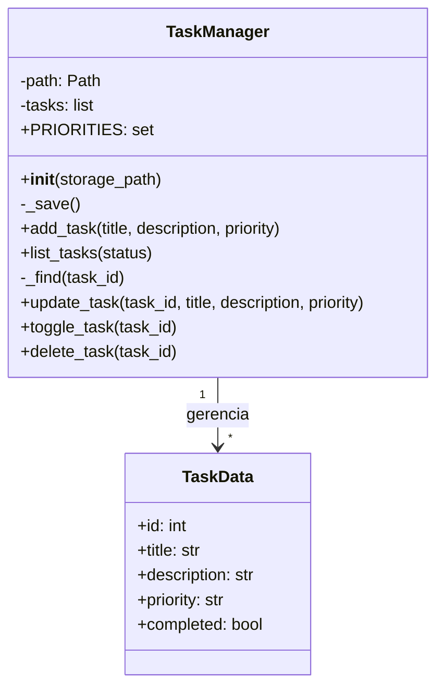

# Diagrama UML de Classes — TechFlow

## Objetivo

Representar a estrutura da classe responsável pelo gerenciamento das tarefas e seus principais atributos e métodos.

## Diagrama

## Descrição

| Elemento | Responsabilidade |
|---|---|
| TaskManager | Gerencia as operações relacionadas às tarefas. |
| path | Define o caminho do arquivo JSON utilizado para armazenamento. |
| tasks | Armazena a lista de tarefas em memória. |
| PRIORITIES | Define as prioridades permitidas: Baixa, Média e Alta. |
| _save() | Salva as tarefas no arquivo JSON. |
| add_task() | Cadastra uma nova tarefa. |
| list_tasks() | Lista e filtra as tarefas. |
| _find() | Localiza uma tarefa pelo identificador. |
| update_task() | Atualiza os dados de uma tarefa. |
| toggle_task() | Alterna o estado de conclusão. |
| delete_task() | Exclui uma tarefa. |

## Estrutura dos dados

Cada tarefa é representada por um dicionário Python contendo:

- id: identificador numérico;
- title: título da tarefa;
- description: descrição;
- priority: prioridade;
- completed: estado de conclusão.

## Conclusão

O diagrama demonstra a responsabilidade central da classe TaskManager e a estrutura dos dados utilizados pelo sistema. Essa modelagem facilita a manutenção e a compreensão do funcionamento da aplicação.
